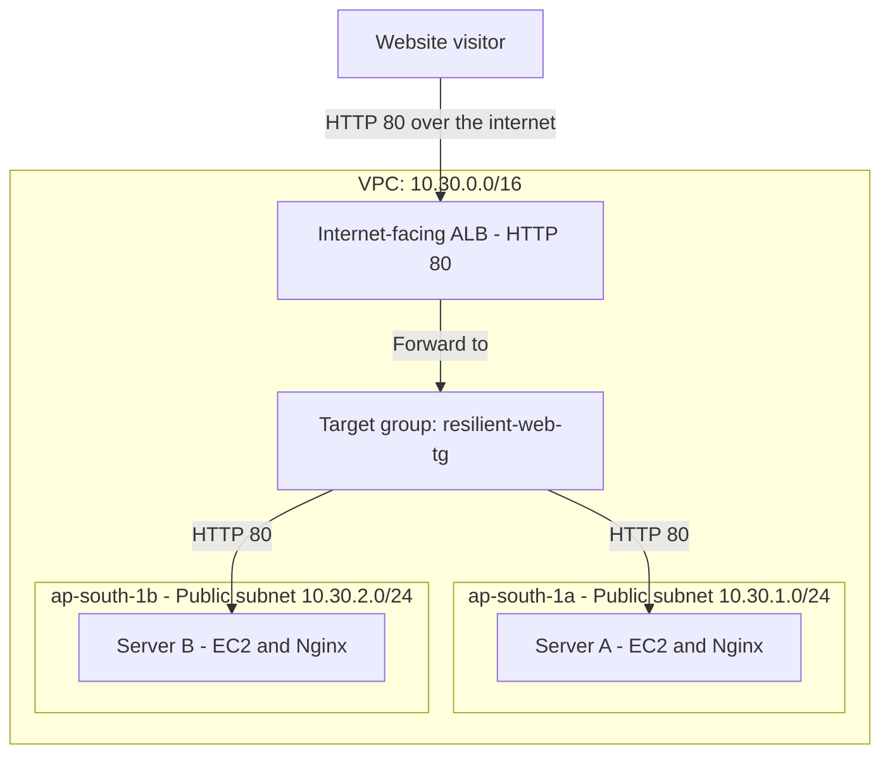

# AWS Resilient Web Hosting Lab

A hands-on cloud and networking project by **Umega Eshan**.

I deployed two Amazon Linux web servers in different Availability Zones behind an Application Load Balancer (ALB). I practised VPC networking, security groups, Linux administration, health checks, log analysis and recovery from a web-service failure.

## What I demonstrated

- Two Nginx servers registered with an ALB target group.
- HTTP traffic forwarded through the ALB to the web servers.
- Web-server HTTP access restricted to the ALB security group.
- A controlled test stopping Nginx on Server A, with the website observed on Server B through the ALB.
- Manual recovery of Server A, followed by both targets returning to Healthy.

This is a learning lab. The test demonstrates handling one web-service failure; it does not establish zero downtime, production readiness or resilience to a complete Availability Zone outage.

## Architecture



This diagram shows logical request routing. The ALB is mapped to both public subnets. A target group is a logical collection, not a separate network appliance. The VPC has an Internet Gateway, and both public subnets use a route table with a default route to it.

## Configuration

| Component | Configuration |
|---|---|
| Region | Mumbai - ap-south-1 |
| VPC | resilient-web-vpc - 10.30.0.0/16 |
| Public subnet A | resilient-public-a - 10.30.1.0/24 - ap-south-1a |
| Public subnet B | resilient-public-b - 10.30.2.0/24 - ap-south-1b |
| Internet Gateway | resilient-web-igw, attached to the VPC |
| Subnet routes | 10.30.0.0/16 to local; 0.0.0.0/0 to the Internet Gateway |
| Server A | resilient-web-a - t3.micro - private IP 10.30.1.56 |
| Server B | resilient-web-b - t3.micro - private IP 10.30.2.73 |
| Operating system | Amazon Linux 2023 |
| Web server | Nginx |
| Website directory | /usr/share/nginx/html |
| ALB | resilient-web-alb - internet-facing - IPv4 |
| Listener | HTTP 80, forwarding to resilient-web-tg |
| Target group | Instance targets, HTTP 80, HTTP/1.1 |

Both EC2 instances use public IPv4 connectivity for this lab. Server B uses an Elastic IP. ALB-to-instance requests use the instances' private addresses.

## Security groups

| Group | Direction | Rule |
|---|---|---|
| resilient-alb-sg | Inbound | TCP 80 from 0.0.0.0/0 |
| resilient-alb-sg | Outbound | TCP 80 to resilient-web-sg |
| resilient-web-sg | Inbound | TCP 80 from resilient-alb-sg |
| resilient-web-sg | Inbound | TCP 22 from my selected public IPv4 address using /32 |
| resilient-web-sg | Outbound | All traffic to 0.0.0.0/0, including software downloads |

The intended browser entry point is the ALB. Public HTTP access directly to the instances is not allowed by these rules. SSH uses a private key, and the SSH source rule must be updated when my public IP changes. Security groups are stateful: responses to allowed connections are automatically permitted.

## Implementation

1. Manually created the VPC, two subnets in different Availability Zones, Internet Gateway and subnet routing through the AWS console.
2. Configured separate ALB and web-server security groups.
3. Launched two EC2 instances and connected using SSH from Windows.
4. Installed Nginx manually and enabled it at boot.
5. Created a distinct index.html on each server identifying Server A or Server B.
6. Registered both instances in an HTTP target group and created the ALB listener.
7. Checked target health, browser responses and Nginx logs.
8. Tested a controlled Nginx failure and manually restored the service.
9. Downloaded both HTML files to the laptop using SCP.

The infrastructure and server setup were manual; this repository does not deploy AWS resources automatically.

## Health checks

| Setting | Value |
|---|---|
| Protocol and port | HTTP, traffic port 80 |
| Path | / |
| Success code | 200 |
| Interval | 30 seconds |
| Timeout | 5 seconds |
| Unhealthy threshold | 2 consecutive failures |
| Healthy threshold | 5 consecutive successes for recovery |

Health checks take time to detect failure and recovery. Requests may fail during failure detection. If all registered targets are unhealthy, ALB can fail open and route to unhealthy targets; this design still needs at least one working web server to serve the site.

## Validation and recovery test

| Check | Recorded result |
|---|---|
| Local HTTP requests on both servers | Custom Server A and Server B pages returned |
| ALB target health before testing | Both targets Healthy |
| Browser requests through ALB | Website displayed |
| Stop Nginx on Server A | Controlled service interruption introduced |
| Browser through ALB while A was stopped | Server B page observed during the lab |
| Restart Nginx on Server A | Local request returned HTTP 200 OK |
| Target health after recovery | Both targets Healthy, captured in the console |
| Nginx access logs on Server A | ALB health checks and browser requests recorded with HTTP 200 |
| Download pages with SCP | Both files transferred successfully |

Commands used on Server A:

```bash
sudo systemctl stop nginx
systemctl is-active nginx
# Observe target health and test the ALB URL from the laptop.
sudo systemctl start nginx
curl -I --max-time 5 http://localhost
sudo tail -n 20 /var/log/nginx/access.log
```

Stopping Nginx affects the web service; the EC2 instance and SSH service can remain running. ALB redirects traffic according to target health, but it does not restart Nginx. I performed that recovery manually. No precise outage duration or availability percentage was measured.

## Reading the logs

- `ELB-HealthChecker/2.0`: periodic ALB health-check requests.
- `GET /` with `200`: successful requests for the home page.
- `HEAD /` with `curl`: the local curl -I check; headers are requested without the response body.
- `::1`: the IPv6 loopback address used by the local check.
- Browser user-agent entries: visitor requests reaching Nginx through the ALB.

## Troubleshooting practised

**Windows private-key permissions:** OpenSSH initially rejected the PEM file because other Windows users had access. I restricted the key's permissions and successfully connected.

**Instance network connectivity:** Server B initially had no public IPv4 address. I associated an Elastic IP for the lab's SSH access and internet connectivity.

**Unused targets:** Both targets initially displayed Unused. I checked the listener forwarding action, ALB state and enabled Availability Zones. Later checks showed both targets Healthy. The exact original cause was not established, so I do not attribute the recovery to an unverified configuration change.

## Repository contents

| Path | Purpose |
|---|---|
| README.md | Architecture, configuration, tests and learning notes |
| website/server-a.html | Copy of Server A's web page |
| website/server-b.html | Copy of Server B's web page |
| screenshots/ | Selected lab evidence, added separately |
| docs/ | Additional setup and troubleshooting notes, when added |
| .gitignore | Excludes private keys and local secrets from new tracking |

Open either HTML file in a browser for a local preview. A local preview does not reproduce the ALB or AWS networking. Private keys and credentials must not be committed. Review screenshots before publishing to remove personal or sensitive information.

## Limitations and cost control

- HTTP only; HTTPS and a custom domain are not configured.
- Two manually managed instances; no Auto Scaling or automatic instance replacement.
- Public subnets for the web servers; no private application tier or NAT Gateway.
- Basic static pages with no database or payment processing.
- Nginx logs and ALB health checks were inspected; custom monitoring alerts are not configured.
- A single-service failure was tested, not a full Availability Zone outage.
- EC2, EBS, ALB, public IPv4 addresses and data usage can consume AWS credits or incur charges under the account's plan. A permanent live demo is not guaranteed.
- Stopping EC2 instances does not remove all costs. After preserving evidence, delete unneeded ALB resources, terminate lab instances as appropriate, remove unneeded volumes and release the Elastic IP when no longer required.

## Planned improvements

- Reproduce the infrastructure with Terraform or CloudFormation.
- Add HTTPS and a custom domain.
- Add CloudWatch alarms and notification testing.
- Explore Auto Scaling and private web-server subnets with an appropriate management and outbound-access design.

## References

- [ALB health checks](https://docs.aws.amazon.com/elasticloadbalancing/latest/application/target-group-health-checks.html)
- [ALB security groups](https://docs.aws.amazon.com/elasticloadbalancing/latest/application/load-balancer-update-security-groups.html)
- [Elastic Load Balancing pricing](https://aws.amazon.com/elasticloadbalancing/pricing/)

